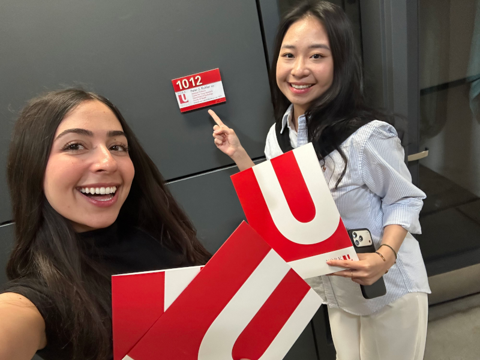

The Kohler Visual Neuroscience Laboratory is delighted to celebrate two of our students, Aurore Maloh and Chi Dao, who received awards for their undergraduate research at York University's Department of Psychology awards reception on November 16, 2026.

Aurore received the **Goranson Memorial Research Award – Best in Person Poster** and a **Certificate of Excellence from the Canadian Psychological Association (CPA)** for her Honours thesis, *Brain Responses to Symmetry in Early Infancy*, nominated by Professors Lara Pierce and Peter Kohler. Chi received the **Originality Prize in Memory of Paul Jeffrey Kuszyszyn** for her paper, *The Influence of Familiarity on Symmetry Perception: A Behavioural Study*, nominated by Professor Peter Kohler.

Both have continued their research in the lab as graduate students: Aurore is now an MA student in Psychology, while Chi is an MSc student in Biology. Congratulations to Aurore and Chi on these well-deserved honours! Unfortunately, I could not attend the ceremony because I am currently on sabbatical in Berlin, but Aurore and Chi took a celebratory photo outside my office to mark the occasion!

